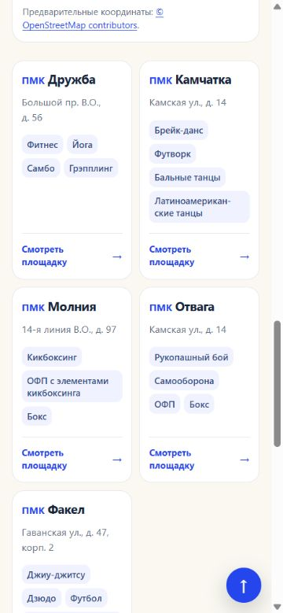
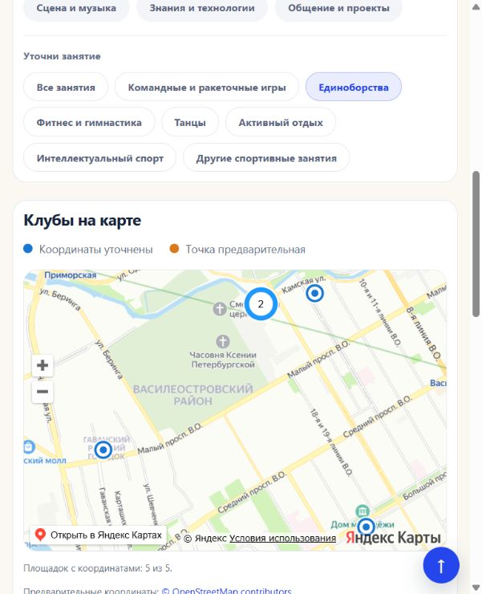
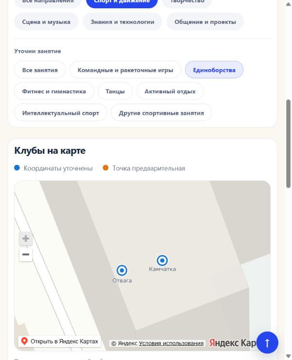

# Карточки и метки карты: S-86-R1, S-87, S-88

**Обновление 28.10.2026:** эта локальная партия позднее опубликована в [S-89](ui-cards-release-2026-10-28.md), 18:53:44 МСК. Ниже сохранена исходная приёмка локальной задачи.

28.10.2026, выполнено локально по последовательным комментариям пользователя в управляющем чате `01a145eb-4fc1-7a92-a9f8-1b64f87ef1b3`. Коммит, push, SSH и публикация этой партии не выполнялись.

## Карточки

Типовая подпись «Подростково-молодёжный клуб» сокращена до «ПМК» и перенесена внутрь заголовка перед названием. Расшифровка сохранена в `title` элемента `abbr`. Изменены 204 типовые карточки; 130 карточек с особыми подписями учреждения или молодёжного пространства сохранили свои обозначения. Плашки направлений стали немного тоньше: `font-weight:550` вместо 650. Две мобильные колонки сохранены.

Проверены фильтр единоборств и ширины 320/375/430/616/1280 px: префикс перед названием, старой верхней подписи у ПМК нет, текст плашек имеет вес 550, переполнения нет. [Проверка всех 334 карточек и сохранности исходных данных](../outputs/S-86-R1/verification.json), [браузер](../outputs/S-86-R1/browser-checks.json).

## Направления в метках

Каждое занятие теперь ссылается на свою уже существующую страницу, даже когда отдельное сообщество VK не указано. Проверены все 2269 ссылок у 332 площадок каталога и 2258 ссылок у 331 площадки районных карт с координатами. Все 2269 маршрутов совпали с прежним алгоритмом; исходный индекс используется до сортировки.

Выше идут страницы с расписанием; далее учитываются отдельные контакты направления, название программы, специалист, регистрация и сведения об условиях. Общие контакты клуба не повышают место отдельного направления. Истёкший архивный график не повышает приоритет расписания. При равенстве сохранён исходный порядок. Порядок карточек направлений внутри клуба не изменялся.

В браузере проверены синие подчёркнутые ссылки «Отваги», переход на «Рукопашный бой» и порядок «Морского»: разговорный клуб первым. [Сверка маршрутов и сортировки](../outputs/S-87/verification.json), [браузер](../outputs/S-87/browser-checks.json).

## Близкие точки

На картах районов и каталога занятий включён штатный [Clusterer Яндекс Карт](https://yandex.ru/dev/jsapi-v2-1/doc/ru/v2-1/ref/reference/Clusterer) с сеткой 64 px. Близкие метки объединяются при отдалении, клик приближает группу, после достаточного приближения видны отдельные метки. Прежние объединённые подсказки для совершенно одинаковых координат сохранены. На общей карте главной новая кластеризация отключена.

Проверено в браузере: «Камчатка» и «Отвага» образуют группу «2», клик раскрывает две отдельные метки; поиск одного клуба снимает группу, сброс восстанавливает её; карта каталога показывает ту же группу при фильтре единоборств Василеостровского района. На главной при 331 исходной площадке видны 327 отдельных значков точек и нет кластеров. [Результаты](../outputs/S-88/browser-checks.json).

## Сборка и сохранность

Итоговые `npm run build` и `npm run check` прошли: 2626 HTML, 2624 canonical URL, ссылки и обязательные прототипы проверены. Один промежуточный перенос `dist` прерывался из-за временного Windows EPERM; следующие сборки завершились без изменения прав доступа или кода публикации. Использован установленный Node 22.17.0; требование engines проекта не менялось.

Изменены общий генератор карточек, CSS, подготовка ссылок направлений и подключение слоя меток в JS. Данные, координаты и все 2676 файлов сохранённых прототипов сверены по SHA256 и не изменены. S-85 «Все направления» сохранена. Следующий шаг: просмотр пользователем и дальнейшие точечные замечания к компактным карточкам.

[Открыть проверенный локальный вариант](http://127.0.0.1:4189/districts/vasileostrovsky.html?topic=sport&subtopic=martial_arts#club-grid).

