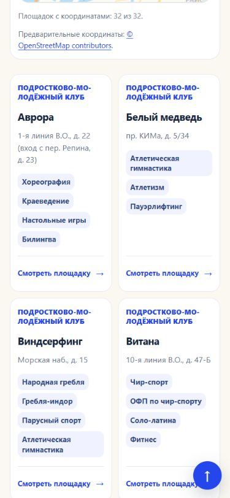
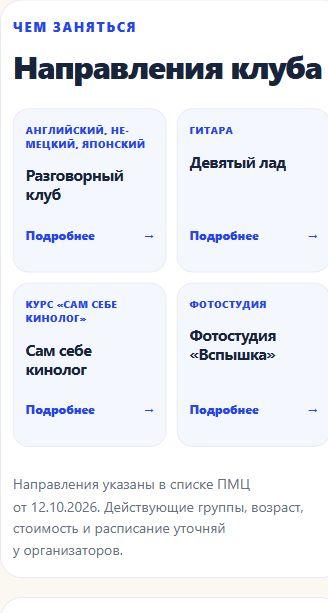

# S-86: мобильные карточки в две колонки

**Обновление 28.10.2026:** эта локальная партия позднее опубликована в [S-89](ui-cards-release-2026-10-28.md), 18:53:44 МСК. Ниже сохранена исходная приёмка локальной задачи.

28.10.2026, выполнено локально в текущем управляющем чате. На публичном сайте остаётся ранее опубликованный вариант. Коммит, push и публикация этой правки не выполнялись.

Карточки клубов в районных списках, на главной и в каталоге занятий, а также направления внутри клуба занимают две колонки на экранах до 760 px. Уменьшены внутренние отступы, заголовки и скругления; длинные слова и подписи переносятся. Названия, адреса, прежние теги, специалисты и предупреждения сохранены полностью, без обрезания строк. Карточки остаются доступными для нажатия и клавиатуры. Вид на широком экране сохранён.

Изменён только `assets/style.css`, затем пересобраны производные файлы. Реализация использует существующие классы и CSS Grid с `minmax(0, 1fr)`. Для карточек направлений уменьшены также поля родительского блока. Общая страница контактов и расписания не менялись. Сохранены отдельная локальная S-85 «Все направления», 19 файлов каталогов/координат и все 2676 файлов в папке prototype; их SHA256 сравнены с началом работы.

## Проверки

- Все 18 районов / 334 клуба на 375 px: две колонки, карточки и их содержимое без горизонтального выхода.
- Шесть вариантов страниц на 320/375/430/760/768/1280 px: район, главная, каталог занятий, «Морской», «Адмиралтеец», «На Богатырском». Всего 36 измерений; переполнений и принудительного обрезания текста нет.
- Поиск «Морской», спортивный фильтр (19 клубов), открытие «Белого медведя», переход в разговорный клуб и открытие бокса с клавиатуры работают. Два пользовательских языковых расписания и расписание бокса доступны по прежним ссылкам.
- S-85: «Все направления» снимает topic и сохраняет Василеостровский район, результаты остаются в две колонки.
- `npm run build` завершён, затем `npm run check`: 2626 HTML, 2624 canonical URL, ссылки и обязательные прототипы проверены. Собранный CSS совпал с исходным. Использован установленный Node 22.17.0; объявленное требование engines проекта не менялось.

[Полные результаты браузера](../outputs/S-86/browser-checks.json), [сверка исходников и прототипов](../outputs/S-86/verification.json), [задание](tasks/S-86.md).

HTTP preview запущен в отдельном открытом терминале и проверен во встроенном браузере:

- [Клубы Василеостровского района](http://127.0.0.1:4189/districts/vasileostrovsky.html#club-grid).
- [Направления «Морского»](http://127.0.0.1:4189/clubs/morskoy.html).
- [Каталог занятий](http://127.0.0.1:4189/directions/index.html?district=vasileostrovsky#results).

## Следующий шаг

После просмотра сетки можно подготовить отдельный вариант содержимого узких карточек: усилить название, сделать спокойнее повторяющуюся подпись типа клуба, упорядочить адрес и направления. Проверить на коротком названии, длинном названии и насыщенном списке занятий. Скрытие сведений, новая структура и этот следующий этап текущей CSS-правкой не реализованы.
