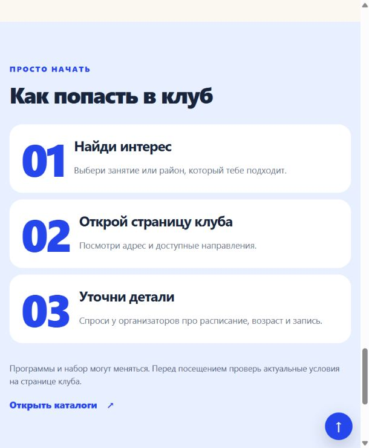

# S-90: крупные номера слева в коротких карточках

28.10.2026, выполнено локально по комментарию пользователя. Крупный номер находится слева, заголовок и пояснение справа. Общий стиль применён к 53 карточкам шагов на главной и 16 районных страницах. Тексты сохранены.

Размер номера подстраивается под ширину карточки: от 52 до 76 px. На телефоне карточки остаются одной колонкой, на планшете сетки сжимаются до двух колонок, на широком экране сохраняются три или четыре. Заголовок и пояснение выровнены по одной левой границе; длинный текст переносится.

Проверены главная и Калининский район с четырьмя шагами в 12 сочетаниях страниц и ширин от 320 до 1280 px. Все 17 страниц / 53 карточки отдельно проверены на 375 px. Номера слева от текста, горизонтальных переполнений нет. `npm run build` и `npm run check` прошли: 2626 HTML / 2624 canonical.

В исходниках изменён только `assets/style.css`. Генератор, JS, 19 файлов каталогов/координат и 2676 сохранённых файлов prototype не изменились; SHA256 сверены. Сборка выполнена установленным Node 22.17.0, требование engines проекта не менялось.

[Проверка](../outputs/S-90/verification.json), [браузерные измерения](../outputs/S-90/browser-checks.json), [задание](tasks/S-90.md), [локальный просмотр](http://127.0.0.1:4189/#how).

Коммит, push, SSH и публикация этой правки не выполнялись. На сервере остаётся ранее опубликованный выпуск S-89. Следующий шаг: просмотр пользователем и дальнейшие точечные замечания.

