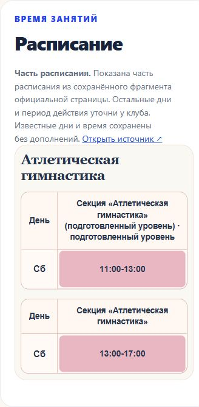

# S-83: публикация подготовленных районов 28.10.2026

**Опубликовано и проверено 28.10.2026, 04:30:10 (МСК)**: [young-russia.ru](https://young-russia.ru/). Выпуск site-data-20261028-mvrf1jxo, пакет сайта [27751b3](https://github.com/IIIWA/young-russia/commit/27751b3bf5f0b24f6ff37db5a5f6425de243c15b). Полная запись результатов: [JSON](site-data-release-2026-10-28.json).

В каталоге 334 клуба / 18 районов. Включены подготовленные сведения S-79/S-81/S-82/S-82-R1/S-84: бесплатные направления и расписания, исправленная пользователем ссылка «Антея», 135 дополнительных таблиц / 776 интервалов и 121 запись о бесплатных направлениях. Петроградский: 29 таблиц / 35 интервалов из 33 сохранённых строк; явно «Часть расписания», остальные дни не придуманы. Свежий Петродворцовый S-79-B-R2 сохранён. [Полный отбор и исключения](remaining-districts-public-import-2026-10-28.md). Платность, архив и неоднозначные площадки остаются в базе; общая сверка с представителями после наполнения сохраняется.

- [Опубликованный фрагмент «Алмаза»](https://young-russia.ru/activities/petrogradsky-almaz-atleticheskaya-gimnastika-01.html#schedule).
- [«Антей» с исправленной ссылкой](https://young-russia.ru/clubs/pushkinsky/antey.html).
- [Каталог с работающим фильтром района](https://young-russia.ru/directions/index.html?topic=knowledge&district=petrogradsky).

Перед переключением заново проверены 4972 файла предыдущего манифеста, полный снимок 23912 файлов, 5507 файлов staging и защищённые служебные файлы. Создан полный бэкап young-russia-before-site-data-20261028-mvrf1jxo.tar.gz, 22505616 байт, SHA256 6f1efc0cc424b65c37bc550ba95c0399333194e2b56ff27a6559a72f5b35a298. Сохранены прежний корень для отката, старые ресурсы открытых вкладок, прототип, robots.txt, .htaccess, публичный ключ и данные комментариев вне webroot. Для комментариев создан отдельный бэкап; исходный файл, его hash и inode после публикации совпали.

Архив: 5507 файлов / 2626 HTML, 11428883 байт, SHA256 913373619250e6a2552e7631843aa888916584ed0a77b030c2fe15a891cb099e. После атомарного переключения проверены все 5507 хешей; 39 серверных HTTP-проверок дали ожидаемые 200/301/404. Независимо снаружи проверены 150 страниц и файлов с точным совпадением хешей, все 135 новых расписаний, 11 специальных случаев, 2624 URL sitemap. Пять закрытых маршрутов возвращают 404, fallback-страницы имеют noindex, перенаправления и Метрика сохранены.

В браузере на 375 px проверены «Алмаз», вокал «На Богатырском», ОФП «Маяка», «Антей» и разговорный клуб «Морского»: горизонтального переполнения нет. У «Антея» отображается bjj_antey, прежний адрес отсутствует. Выбор Петроградского в каталоге обновляет URL и карту (7 из 7 площадок в выбранной категории). Один переход сообщил таймаут ожидания браузера; после чтения состояния целевой документ и таблицы были видны, проверка продолжилась. [HTTP-свидетельства](../outputs/S-83/live-http-verification.json), [браузер](../outputs/S-83/live-browser-mobile.json), [фильтр](../outputs/S-83/live-browser-filter.json), [полная запись выпуска](../outputs/S-83/deployment-verification.json).

Первые два подключения завершились до переключения (закрытие stdin после staging и ошибка формата JSON в скрипте продолжения). После исправления передача полного манифеста, кириллицы, повторных команд и сохранение соединения после ошибки проверены локально на Python; третья интерактивная сессия выполнила публикацию и закрыта явно. Перед каждой сессией получен отдельный свежий ответ пользователя. [Проверка протокола](../outputs/S-83/transport-verification.json).

Ограничения: прямой просмотр VK заблокирован политикой браузерного инструмента; доступность всех сообществ не объявляется проверенной, bjj_antey сообщил пользователь. Балл PageSpeed не измерялся. Финальная локальная сборка прошла на Node 22.17 с предупреждением engines после отказа Windows запускать штатный Node 24.22.1; требование версии не менялось. Сайт публикуется статическими файлами. Детали подготовки и Git-состава: [S-83](git-release-preparation-2026-10-28.md).

Следующее: продолжение наполнения и уточнений по единому реестру, затем общая сверка с представителями. Отдельная редакторская правка: сократить служебные фрагменты заголовков PDF в подписях источников Приморского, сохранив даты. Новые задачи этой публикацией не запущены.
