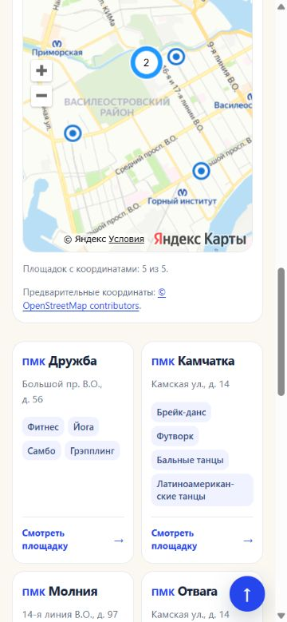

# S-89: выпуск интерфейса от 28.10.2026

Статус: опубликовано 28.10.2026 в 18:53:44 МСК и проверено на https://young-russia.ru/. Публикация выполнена до коммита по прямому поручению пользователя. Git-этап следует после этой проверки.

## Состав

Полная публичная партия S-85/S-86/S-86-R1/S-87/S-88: «Все направления», две колонки карточек на телефоне, «ПМК» перед названием, более тонкий текст плашек, ссылки всех занятий в метках и порядок по заполненности, группировка близких точек на районных картах и в каталоге. На общей карте главной группировка отключена.

Изменения общих шаблонов и ресурсов проверены на всех 2624 содержательных страницах; каталог сохраняет 334 клуба / 18 районов. Данные, координаты и 2676 сохранённых файлов prototype не изменились. Внутренний локальный `data/research/pmc-club-contact-audit.json` остаётся вне выпуска и нового коммита в прежней границе S-83.

## Опубликованный пакет

- Выпуск `ui-cards-20261028-mvsafm37`: 5512 файлов / 2626 HTML / 2624 canonical.
- Архив: 11 709 867 байт, SHA256 `b9b664cf327f482937699d44e687ecb0d8d14c4d3d8b5bed28ad08f970043b29`.
- Baseline для проверки сервера: 5507 файлов выпуска `site-data-20261028-mvrf1jxo`.
- Сборка/check завершились успешно; все 2269 маршрутов занятий сохранены, ссылки проверены. В браузере финальной сборки подтверждены мобильные две колонки, ПМК, вес плашек 550, группа «2» и работа «Всех направлений» с сохранением района.
- Протокол одной постоянной SSH-сессии проверен локально с реальными метаданными и всем архивом: передача после baseline, SHA256, Unicode, продолжение после ошибки, вложенный цикл команд и явное закрытие.

[Глобальная проверка](../outputs/S-89/global-check.json), [пакет](../outputs/S-89/prepared.json), [браузер](../outputs/S-89/browser-preflight.json), [тест передачи](../outputs/S-89/transport-verification.json), [задание](tasks/S-89.md).

Публикация выполнена через одну постоянную SSH-сессию после свежего ответа пользователя о присутствии. Все 5507 файлов baseline совпали; перед переключением сохранён полный бэкап и проверены все 5512 файлов staging. После переключения повторно проверены 5512 хешей. SSH явно закрыта после успешных внешних проверок.

Среда: итоговая сборка выполнена установленным Node 22.17.0; объявленные engines проекта не менялись. Балл PageSpeed не измерялся.

## Приёмка production

Бэкап `young-russia-before-ui-cards-20261028-mvsafm37.tar.gz`: 24390548 байт, SHA256 `48c732dad90900e7a097089d5b98aba4c821999b12319d4a6c73e4bc99817378`. Предыдущий корень сохранён для отката. Служебные robots.txt, .htaccess и IndexNow-файл не изменились. Все 1659 файлов серверного прототипа совпали с прежней версией; комментарии сохранили SHA256 и inode. Серверный прототип отличается от 2676 локальных сохранённых файлов и не заменялся ими.

Проверены 50 серверных HTTP-случаев (41 × 200, 3 × 301, 6 × 404), 36 внешних страниц/ресурсов с точным совпадением SHA256 и 11 специальных случаев. Браузер подтвердил мобильные две колонки, ПМК, плашки 550, распад группы «2» на две метки, синие подчёркнутые ссылки и переход на нужное занятие, «Все направления» с сохранением района и отсутствие кластеризации на главной.

[JSON выпуска](ui-cards-release-2026-10-28.json), [внешние проверки](../outputs/S-89/live-http.json), [браузер](../outputs/S-89/live-browser.json).

[Опубликованный пример](https://young-russia.ru/districts/vasileostrovsky.html?topic=sport&subtopic=martial_arts#club-grid).

